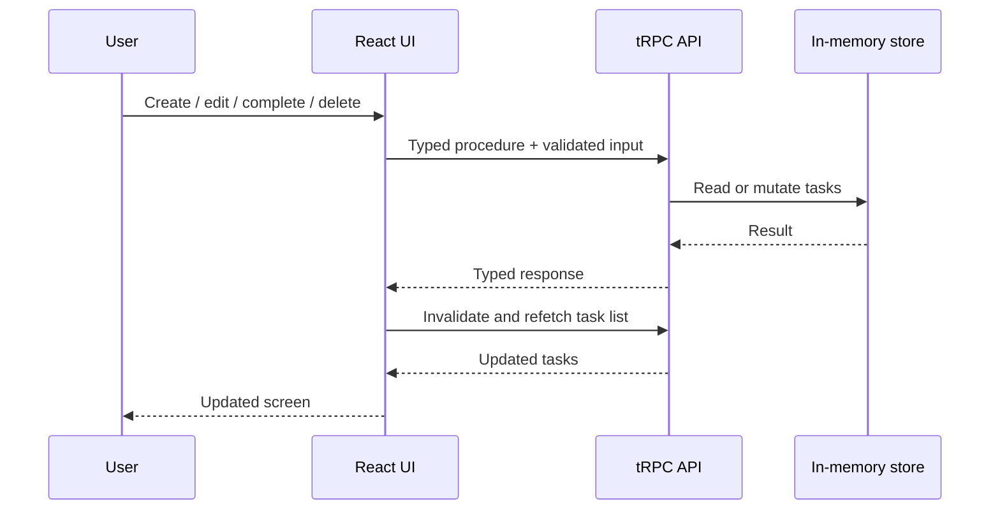
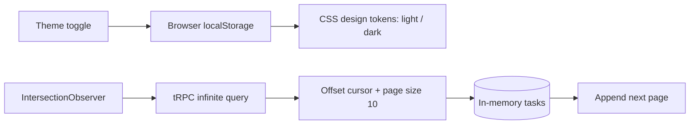

# Task Manager — Next.js 15 + tRPC

A full-stack task management application developed as a technical case. The UI and server API live in a **single Next.js 15 project**, with end-to-end type safety using **tRPC** and input validation using **Zod**.

## Architecture


## Task lifecycle



## Features

- Create tasks with a required title and optional description.
- Read tasks with **server-side rendering (SSR)** on the initial request.
- Edit titles and descriptions; mark tasks as completed or incomplete.
- Delete tasks with a confirmation dialog.
- Zod input validation and user-facing errors.
- Typed client-server communication using tRPC and React Query.
- Responsive layout and empty-state feedback.\n- Artefact-inspired pink and blue palette with a persistent light/dark mode toggle.\n- Infinite scrolling with 10-task pages and IntersectionObserver (plus manual load-more fallback).\n- Docker multi-stage build and Docker Compose for repeatable local execution.

## Tech stack

Next.js 15 (App Router), React 19, TypeScript, tRPC 11, TanStack Query, Zod, Tailwind CSS 4.

## Run locally

Requirements: Node.js 20+ and npm.

```bash
npm install
npm run dev
```

Open http://localhost:3000.

For a production build:

```bash
npm run build
npm run start
```

## Docker

Build and run with Docker Compose:

```bash
docker compose up --build
```

Open http://localhost:3000. Stop with `docker compose down`.

Or use Docker directly:

```bash
docker build -t task-manager-trpc .
docker run --rm -p 3000:3000 task-manager-trpc
```

> Data lives in process memory only. A container restart resets all tasks.

## Theme and pagination flow



## API procedures

| Procedure | Type | Purpose |
| --- | --- | --- |
| `tasks.list` | query | List all tasks (legacy helper) |\n| `tasks.infinite` | query | Cursor-based task pages (offset cursor, 10 by default) |
| `tasks.create` | mutation | Create a task |
| `tasks.update` | mutation | Update task fields or completion |
| `tasks.delete` | mutation | Delete a task |

## Implementation notes and trade-offs

- **SSR:** the root page is a dynamic Server Component that loads the first page using a server-side tRPC caller, then passes it as initial data to the interactive client component.\n- **Pagination:** the server uses an offset cursor. This is simple for an in-memory exercise, but concurrent inserts/deletes can shift page boundaries; a production system should use a stable keyset cursor and persistent database.
- **Storage:** tasks are held in server process memory, as required by the exercise. They are **not durable**: server restarts and deployments clear them. Multiple instances would not share state.
- **Scope:** no database, login, or external API is necessary for this case. A production version would use persistent storage, authorization, and automated tests.
- **Security:** tRPC provides typed contracts, **not authentication or authorization**. Zod validates input at the server boundary.
- **Theme:** the switch is stored in localStorage and falls back to the operating system preference.\n- **Docker:** the container uses one Node.js process. Restarting it clears in-memory tasks.\n- **Validation:** automated build/tests have not yet been executed in this environment.

## Project structure

```text
src/
  app/
    api/trpc/[trpc]/route.ts  # HTTP adapter
    page.tsx                  # SSR initial data
  components/
    TaskManager.tsx           # CRUD + infinite scroll\n    ThemeToggle.tsx           # Light/dark mode
    TrpcProvider.tsx          # React Query and tRPC provider
  server/
    routers/tasks.ts          # Typed CRUD procedures + Zod
    routers/index.ts          # App router
    store.ts                  # In-memory task storage
    trpc.ts                   # tRPC initialization
  utils/trpc.ts               # Client-side tRPC hooks
```
