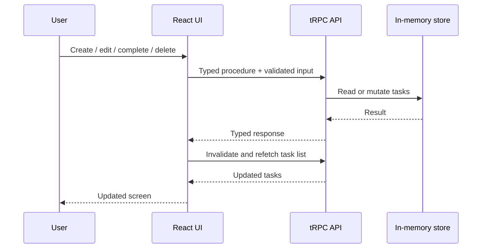
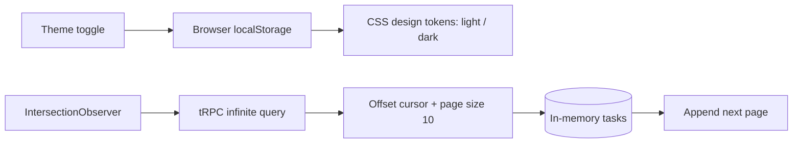

# Task Manager — Next.js 15 + tRPC

A full-stack task management application developed as a technical case. The UI and server API live in a **single Next.js 15 project**, with end-to-end type safety using **tRPC** and input validation using **Zod**.

## Live demo

**Production deployment (Railway):** https://task-manager-trpc-production.up.railway.app

The demo runs as a Node.js service with **one replica**. Task data is intentionally kept in process memory, following the technical-case requirements. **Tasks are reset on application restarts or redeployments**; the live demo is not a persistent multi-user product.

## Architecture


## Task lifecycle



## Features

- Create tasks with a required title and optional description.
- Read tasks with **server-side rendering (SSR)** on the initial request.
- Edit titles and descriptions; mark tasks as completed or incomplete.
- Delete tasks with a confirmation dialog.
- Zod input validation and user-facing errors.
- Typed client-server communication using tRPC and React Query.
- Responsive layout and empty-state feedback.
- Artefact-inspired pink and blue palette with a persistent light/dark mode toggle.
- Infinite scrolling with 10-task pages and IntersectionObserver (plus manual load-more fallback).
- Docker multi-stage build and Docker Compose for repeatable local execution.
- Portuguese (Brazil) / English interface with `next-intl`, browser language detection, and persisted preference.
- Vitest unit, component and HTTP integration tests for storage, tRPC validation, CRUD, pagination, theme, language and user interactions.
- Playwright Chromium browser tests for the primary task workflow, theme, language and infinite scrolling.
- V8 code coverage report with enforced minimums (80% lines/statements/functions, 70% branches) and GitHub Actions CI.

## Tech stack

Next.js 15 (App Router), React 19, TypeScript, tRPC 11, TanStack Query, Zod, Tailwind CSS 4, next-intl, Vitest.

## Run locally

Requirements: Node.js 20+ and npm.

```bash
npm install
npm run dev
```

Open http://localhost:3000.

For a production build:

```bash
npm run build
npm run start
```

## Verified results (October 31, 2026)

The following checks were completed locally on Windows after the latest E2E test fixes:

| Check | Result |
| --- | --- |
| Vitest unit, component and integration tests | **24 passed** across 7 test files |
| Playwright Chromium E2E tests | **2 passed** (CRUD/theme/language and pagination) |
| V8 statement coverage | **100%** |
| V8 branch coverage | **87.85%** |
| V8 function coverage | **82.05%** |
| V8 line coverage | **100%** |
| Next.js production build | **Successful** (`next build`) |
| TypeScript check during build | **Passed** |
| ESLint during build | **Passed with two unused-parameter warnings** in the test setup |
| Railway deployment | **Successful / active** (production) |

These results describe the tested revision and local environment, not a guarantee of defect-free behavior. GitHub Actions also completed successfully before the latest E2E changes; review the [latest workflow status](https://github.com/FATEC-BOYS/task-manager-trpc/actions) for the current revision.

## Quality checks

```bash
npm run lint
npm run typecheck
npm run test
npm run coverage
npm run build
npx playwright install chromium
npm run test:e2e
```

The GitHub Actions workflow runs lint, typecheck, coverage, build, and Playwright tests on pushes and pull requests. Coverage HTML and browser failure traces are uploaded as artifacts. Coverage thresholds apply to the included server, API, component and translation source files, not generated files or configuration. A successful CI run is required before treating the case as verified.

## Deployment on Railway

The project is deployed from the public GitHub repository to Railway as a Node.js/Next.js application. Use `npm run build` as the build command and `npm run start` as the start command if manual configuration is needed; Railway must provide the `PORT` environment variable and expose the application's listening port. No database or secrets are needed for this exercise.

**Live URL:** https://task-manager-trpc-production.up.railway.app

The deployment is intended for evaluation, not durable storage: in-memory data is lost on restarts/redeployments, and separate replicas would not share tasks.

## Docker

Build and run with Docker Compose:

```bash
docker compose up --build
```

Open http://localhost:3000. Stop with `docker compose down`.

Or use Docker directly:

```bash
docker build -t task-manager-trpc .
docker run --rm -p 3000:3000 task-manager-trpc
```

> Data lives in process memory only. A container restart resets all tasks.

## Theme and pagination flow



## API procedures

| Procedure | Type | Purpose |
| --- | --- | --- |
| `tasks.list` | query | List all tasks (legacy helper) |
| `tasks.infinite` | query | Cursor-based task pages (offset cursor, 10 by default) |
| `tasks.create` | mutation | Create a task |
| `tasks.update` | mutation | Update task fields or completion |
| `tasks.delete` | mutation | Delete a task |

## Implementation notes and trade-offs

- **SSR:** the root page is a dynamic Server Component that loads the first page using a server-side tRPC caller, then passes it as initial data to the interactive client component.
- **Pagination:** the server uses an offset cursor. This is simple for an in-memory exercise, but concurrent inserts/deletes can shift page boundaries; a production system should use a stable keyset cursor and persistent database.
- **Storage:** tasks are held in server process memory, as required by the exercise. They are **not durable**: server restarts and deployments clear them. Multiple instances would not share state.
- **Scope:** no database, login, or external API is necessary for this case. A production version would use persistent storage and authorization; this case already includes automated tests.
- **Security:** tRPC provides typed contracts, **not authentication or authorization**. Zod validates input at the server boundary.
- **Theme:** the switch is stored in localStorage and falls back to the operating system preference.
- **Internationalization:** next-intl handles English and Brazilian Portuguese messages in the client; browser language and saved preference determine the active locale. The SSR document defaults to English, then updates after hydration.
- **Docker:** the container uses one Node.js process. Restarting it clears in-memory tasks.
- **Validation:** Vitest and Playwright passed locally on October 31, 2026 (see measured results above). Coverage thresholds are enforced in the test configuration. The production build completed with two non-blocking ESLint warnings in test setup.

## Project structure

```text
src/
  app/
    api/trpc/[trpc]/route.ts  # HTTP adapter
    page.tsx                  # SSR initial data
  components/
    TaskManager.tsx           # CRUD + infinite scroll
    ThemeToggle.tsx           # Light/dark mode
    LanguageToggle.tsx        # Language selection
    LocaleProvider.tsx        # next-intl messages and locale state
    TrpcProvider.tsx          # React Query and tRPC provider
  server/
    routers/tasks.ts          # Typed CRUD procedures + Zod
    routers/index.ts          # App router
    store.ts                  # In-memory task storage
    trpc.ts                   # tRPC initialization
  i18n/messages.ts             # English / Portuguese strings
  utils/trpc.ts               # Client-side tRPC hooks
```
