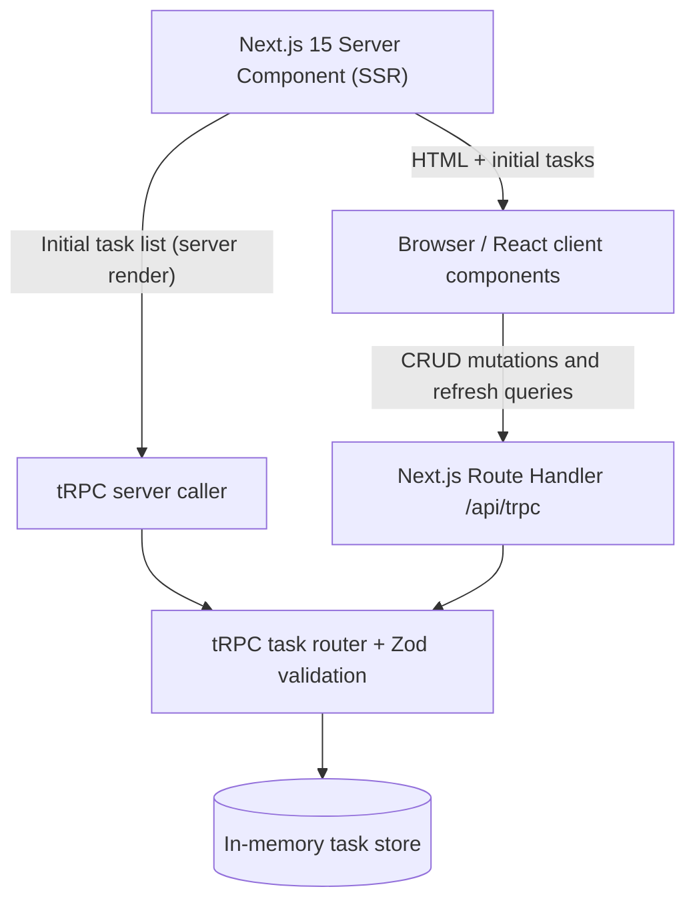
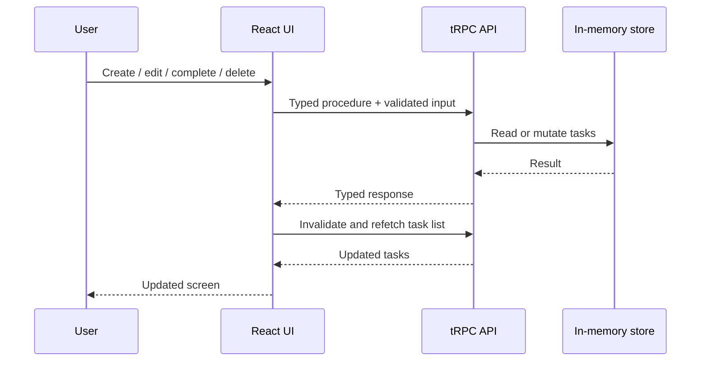

# Task Manager — Next.js 15 + tRPC

A full-stack task management application developed as a technical case. The UI and server API live in a **single Next.js 15 project**, with end-to-end type safety using **tRPC** and input validation using **Zod**.

## Architecture



## Task lifecycle



## Features

- Create tasks with a required title and optional description.
- Read tasks with **server-side rendering (SSR)** on the initial request.
- Edit titles and descriptions; mark tasks as completed or incomplete.
- Delete tasks with a confirmation dialog.
- Zod input validation and user-facing errors.
- Typed client-server communication using tRPC and React Query.
- Responsive layout and empty-state feedback.

## Tech stack

Next.js 15 (App Router), React 19, TypeScript, tRPC 11, TanStack Query, Zod, Tailwind CSS 4.

## Run locally

Requirements: Node.js 20+ and npm.

```bash
npm install
npm run dev
```

Open http://localhost:3000.

For a production build:

```bash
npm run build
npm run start
```

## API procedures

| Procedure | Type | Purpose |
| --- | --- | --- |
| `tasks.list` | query | List all tasks |
| `tasks.create` | mutation | Create a task |
| `tasks.update` | mutation | Update task fields or completion |
| `tasks.delete` | mutation | Delete a task |

## Implementation notes and trade-offs

- **SSR:** the root page is a dynamic Server Component that loads tasks using a server-side tRPC caller, then passes them as initial data to the interactive client component.
- **Storage:** tasks are held in server process memory, as required by the exercise. They are **not durable**: server restarts and deployments clear them. Multiple instances would not share state.
- **Scope:** no database, login, or external API is necessary for this case. A production version would use persistent storage, authorization, and automated tests.
- **Security:** tRPC provides typed contracts, **not authentication or authorization**. Zod validates input at the server boundary.
- **Optional enhancement:** infinite scrolling is not implemented in this version.

## Project structure

```text
src/
  app/
    api/trpc/[trpc]/route.ts  # HTTP adapter
    page.tsx                  # SSR initial data
  components/
    TaskManager.tsx           # CRUD interface
    TrpcProvider.tsx          # React Query and tRPC provider
  server/
    routers/tasks.ts          # Typed CRUD procedures + Zod
    routers/index.ts          # App router
    store.ts                  # In-memory task storage
    trpc.ts                   # tRPC initialization
  utils/trpc.ts               # Client-side tRPC hooks
```
